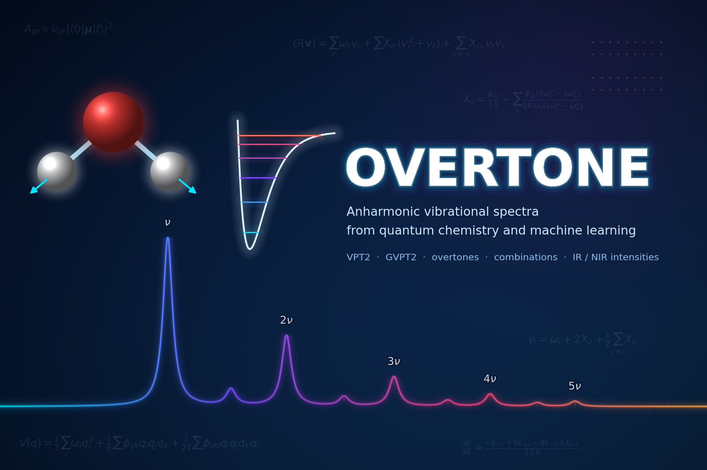

# OVERTONE

`overtone` computes anharmonic vibrational spectra with second-order vibrational
perturbation theory (VPT2). It works with any calculator of the Atomic
Simulation Environment (ASE), from quantum chemistry programs such as ORCA or
PySCF to machine-learning potentials, on-the-fly active learning with FALCON,
and variational quantum algorithms on (simulated) quantum computers.

`overtone` provides fundamentals, overtones and combination bands, IR
intensities on request, and plotted spectra including the near-IR.

-   :material-clock-fast:{ .lg .middle } __Set up in 5 minutes__

    ---

    Install `overtone` with [`pip`](https://pypi.org/project/overtone-vpt2/) and get up
    and running in minutes

    [:octicons-arrow-right-24: Getting started](#)

-   :lucide-gift:{ .lg .middle } __Example__

    ---

    Get started with a quick example

    [:octicons-arrow-right-24: Tutorials](mini_example.md)

-   :octicons-mortar-board-24:{ .lg .middle } __Tutorials__

    ---

    Check out the tutorials to learn more

    [:octicons-arrow-right-24: Tutorials](tutorials/index.md)

-   :lucide-shield-question-mark:{ .lg .middle } __Manual__

    ---

    Consult the manual for more information

    [:octicons-arrow-right-24: Tutorials](manual.md)

## Features

* Harmonic analysis with symmetrised Hessian and Eckart projection of translations and rotations
* Quartic force field from energies or forces by finite differences in dimensionless normal coordinates
* VPT2 variants: GVPT2 (default), standard VPT2, deperturbed VPT2 and DCPT2
* Automatic detection of Fermi resonances and variational treatment, including intensity borrowing
* Coriolis contributions, linear molecules, constrained atoms (e.g. adsorbates on surfaces)
* Overtones and combination bands up to any number of quanta
* IR intensities (only computed on request, e.g. not for energy-only ML potentials)
* Lorentzian and Gaussian spectra, log scale for the near-IR, experimental reference overlay
* Hybrid schemes with separate calculators for the Hessian and the anharmonic part
* Runs on a single node or distributed over a queueing system with Shephex

## Authors

Basila Bhanu Pattani Ameerjan, Mads-Peter Verner Christiansen and Wilke Dononelli

## License

This project is licensed under the GPL-3.0 License.

## Citation

Please cite the OVERTONE paper (in preparation) when using the code.
