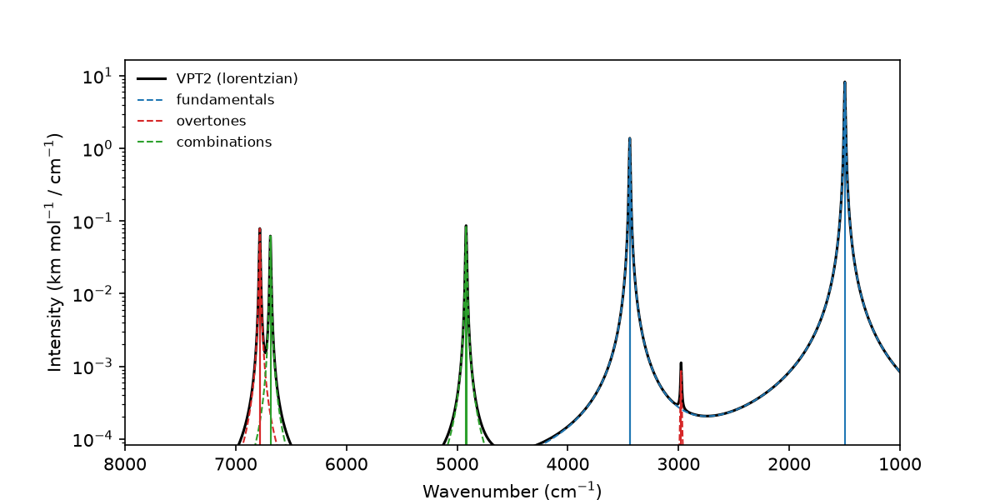

# 1. Anharmonic spectrum in one call

Water is the simplest molecule with a rich vibrational spectrum. Its three
fundamentals are accompanied by overtones and combination bands that reach far
into the near-IR. This tutorial shows that a complete anharmonic spectrum
requires only a calculator and a single function call.

This tutorial demonstrates:

- Geometry optimization of water with GFN2-xTB
- The complete OVERTONE workflow with the function `calculate_anharmonics`
- Fundamentals, overtones and combination bands up to three quanta
- IR intensities computed on request
- Plotting of the spectrum on a logarithmic scale

The core idea of OVERTONE is that any ASE calculator provides energies, forces
and dipole moments, and OVERTONE turns them into an anharmonic vibrational
spectrum. This script is optimized for clarity and speed rather than accuracy.

```bash
python 01_quickstart.py
```

## Step 1: Define the calculator

```python
--8<-- "tutorials/01_quickstart.py:calculator"
```

OVERTONE needs a function that returns a fresh calculator. Every displaced
structure gets its own calculator. The SCF is converged tightly
(`accuracy=0.01`), because the finite differences amplify numerical noise.

## Step 2: Optimize the structure

```python
--8<-- "tutorials/01_quickstart.py:optimise"
```

VPT2 expands the potential around a minimum. The geometry must therefore be
optimized tightly.

## Step 3: Run the complete workflow

```python
--8<-- "tutorials/01_quickstart.py:workflow"
```

This single call performs the harmonic analysis, generates the displaced
structures, computes all single points, assembles the quartic force field and
solves the VPT2 equations. By default OVERTONE uses GVPT2, which treats Fermi
resonances variationally.

With `dry_run=True` the function only reports how many single points a
calculation will need. For energy-only calculators, such as many
machine-learning potentials, keep `intensities=False`.

## Step 4: Inspect and plot the results

```python
--8<-- "tutorials/01_quickstart.py:results"
```

`calculate_anharmonics` has already printed the table of transitions, which
lists every band with its harmonic and anharmonic wavenumber and its
intensity. Bands that take part in a Fermi resonance are marked. The
logarithmic scale makes the weak overtones and combination bands of the
near-IR visible next to the strong fundamentals.



## Output files

- `water_quickstart/`: all intermediate results as JSON files (harmonic analysis, force field, dipoles, VPT2)
- `water_quickstart.png`: the computed spectrum

## Full script

```python title="01_quickstart.py"
--8<-- "tutorials/01_quickstart.py"
```
