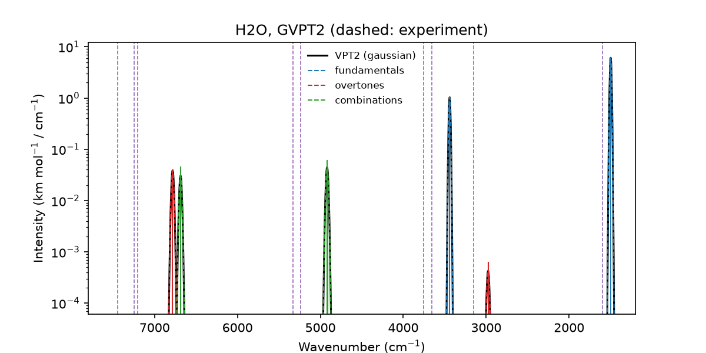
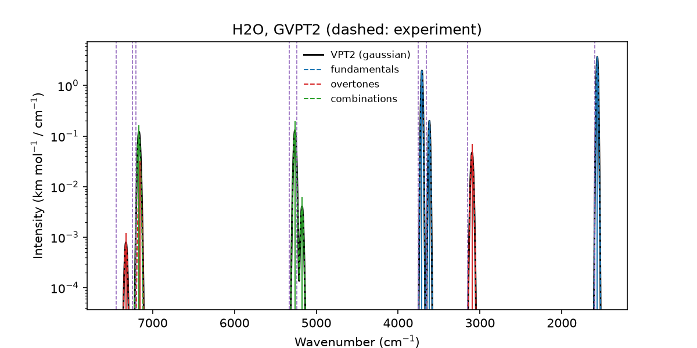

# 3. Comparison with experiment

Water has been measured far into the near-IR, where overtones and combination
bands dominate the spectrum. This tutorial compares the computed bands with
the experimental band positions up to two quanta, first with GFN2-xTB and then
with B3LYP from PySCF.

This tutorial demonstrates:

- Overtones and combination bands in the near-IR region
- Comparing computed bands with experimental band positions
- Exchanging the calculator for a more accurate one

```bash
python 03_water_vs_experiment.py
```

## Step 1: Experimental band positions

```python
--8<-- "tutorials/03_water_vs_experiment.py:experiment"
```

The band centres are taken from J. Chem. Theory Comput. 10, 5426 (2014).
`v1` and `v3` are the symmetric and antisymmetric OH stretches, `v2` the bend.

## Step 2: The calculator

=== "GFN2-xTB (runs in seconds)"

    ```python
    --8<-- "tutorials/03_water_vs_experiment.py:calculator"
    ```

=== "B3LYP with PySCF (a few minutes)"

    ```python
    from pyscf_calculator import PySCFCalculator

    def setup():
        return PySCFCalculator(xc="b3lyp", basis="def2-tzvp")
    ```

The script uses GFN2-xTB, so it runs in seconds. For quantitative results,
replace `setup` by the PySCF version. `PySCFCalculator` is a small ASE
calculator in
[`tutorials/pyscf_calculator.py`](https://github.com/thequantumchemist/overtone/blob/main/tutorials/pyscf_calculator.py)
with analytic forces and dipole moments. It converges the SCF to
10⁻¹¹ Hartree and uses a fine integration grid, because the finite
differences amplify SCF and grid noise. Nothing else in the script changes.

## Step 3: Spectrum and experimental band positions

```python
--8<-- "tutorials/03_water_vs_experiment.py:workflow"
```

```python
--8<-- "tutorials/03_water_vs_experiment.py:plot"
```

The experimental band positions are drawn as dashed lines.

=== "GFN2-xTB"

    

=== "B3LYP/def2-TZVP"

    

## What to expect

| Band | Experiment | GFN2-xTB | B3LYP/def2-TZVP |
|---|---:|---:|---:|
| ν₂ | 1595 | 1498 | 1567 |
| 2ν₂ | 3152 | 2977 | 3097 |
| ν₁ | 3657 | 3440 | 3618 |
| ν₃ | 3756 | 3441 | 3709 |
| ν₁+ν₂ | 5235 | 4919 | 5174 |
| ν₂+ν₃ | 5331 | 4914 | 5260 |
| 2ν₁ | 7202 | 6782 | 7154 |
| ν₁+ν₃ | 7250 | 6687 | 7168 |
| 2ν₃ | 7445 | 6782 | 7325 |

All values in cm⁻¹. GFN2-xTB places the OH stretches 200-300 cm⁻¹ too low and
the near-IR bands up to 560 cm⁻¹ too low. It also makes the two stretches
nearly degenerate. With B3LYP, all bands lie within about 2 % of experiment,
which is typical for this functional. The largest deviations occur for the
stretching overtones near 7200-7450 cm⁻¹, where Darling-Dennison coupling
mixes the states. OVERTONE does not include this coupling.

## Output files

- `water_vs_experiment/`: all intermediate results
- `water_vs_experiment.png`: computed spectrum with the experimental band positions as dashed lines

## Full script

```python title="03_water_vs_experiment.py"
--8<-- "tutorials/03_water_vs_experiment.py"
```
