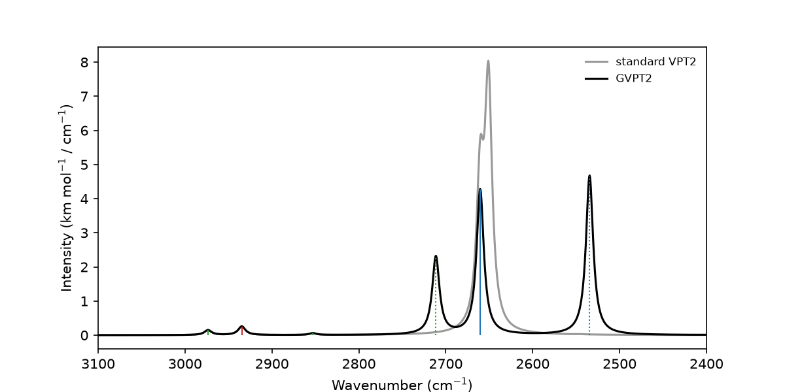

# 4. Fermi resonances and GVPT2

In formaldehyde, one CH stretching fundamental lies close to a combination
band of two lower modes. The two states mix. Standard VPT2 cannot describe
this and gives a misleading position. GVPT2 treats the coupled states
variationally. It also shows how the combination band borrows intensity from
the fundamental, which is essential for interpreting real spectra.

This tutorial demonstrates:

- Automatic detection of Fermi resonances
- How standard VPT2 fails near a resonance
- Repeating the VPT2 step with all variants from saved files, without new single points
- State mixing and intensity borrowing in GVPT2

```bash
python 04_fermi_resonances.py
```



## Output files

- `formaldehyde/`: all intermediate results
- `formaldehyde_resonance.png`: CH stretching region with standard VPT2 and GVPT2

## Full script

```python title="04_fermi_resonances.py"
--8<-- "tutorials/04_fermi_resonances.py"
```
