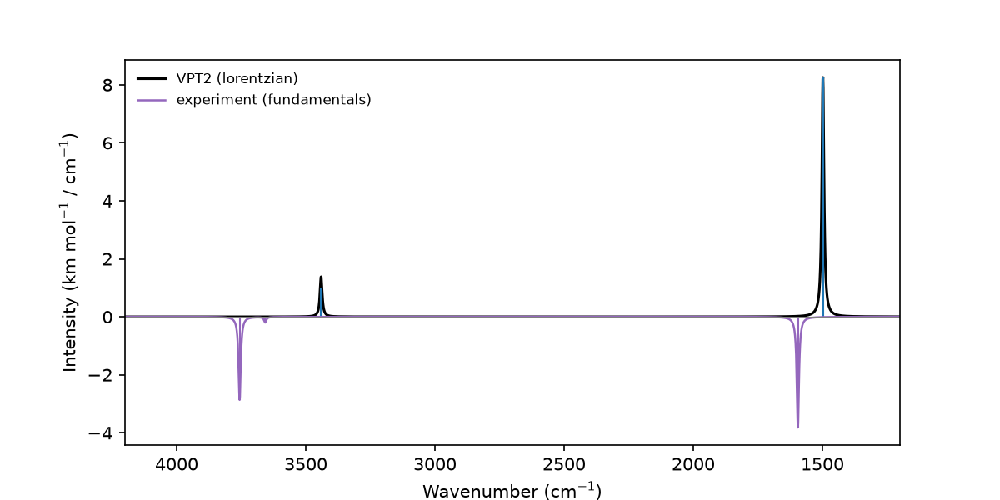

# 5. Analysis of a finished run

Single points are the expensive part of every calculation. Once they are
stored, the VPT2 step can be repeated with other settings in seconds, and
spectra can be replotted or exported for comparison with measurements.

This tutorial demonstrates:

- Reloading saved results
- Selecting bands by type and wavenumber range
- Repeating the VPT2 step with other settings, e.g. without Coriolis terms
- Exporting the broadened spectrum as a data file
- Plotting a spectrum together with reference bands

Run it after [tutorial 1](01-quickstart.md), whose saved results it reads:

```bash
python 05_analysis.py
```



## Output files

- `water_spectrum.dat`: broadened spectrum as two columns
- `water_vs_reference.png`: spectrum with mirrored reference bands

## Full script

```python title="05_analysis.py"
--8<-- "tutorials/05_analysis.py"
```
